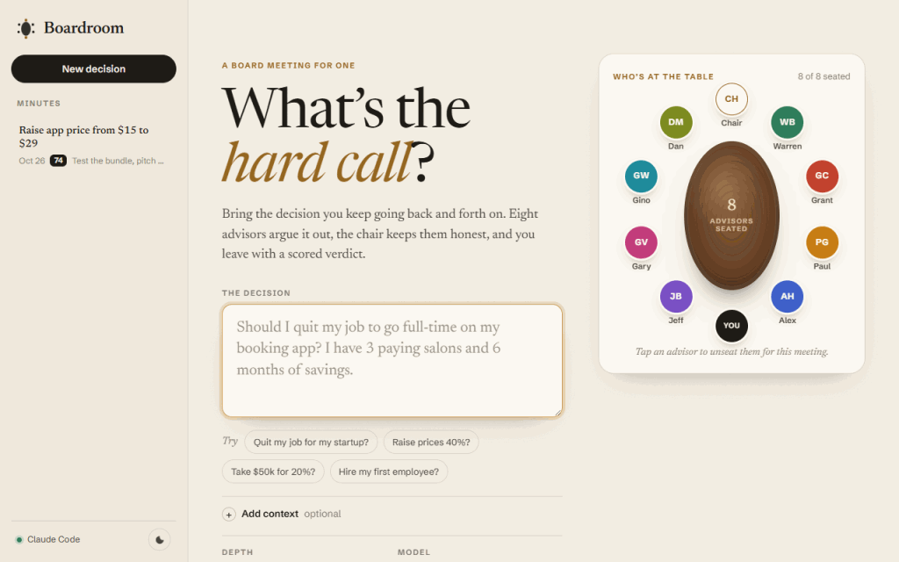
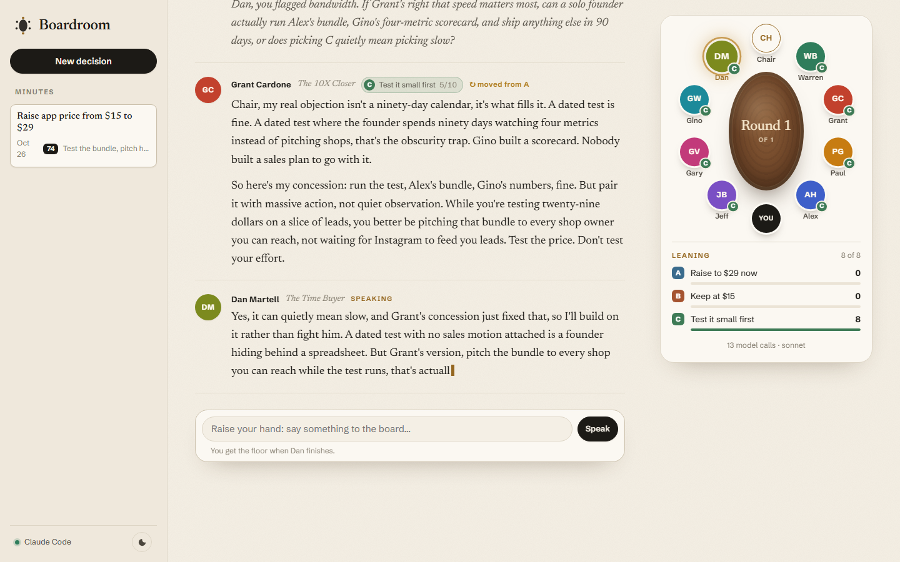
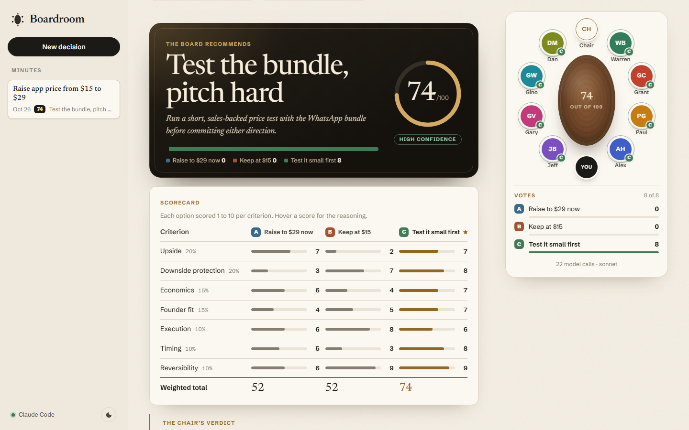

<div align="center">

# Boardroom

**Bring a hard business decision. Eight AI advisors argue it out around a table. You leave with a scored verdict.**

A local app where a board of AI advisors, inspired by Warren Buffett, Jeff Bezos, Paul Graham, Alex Hormozi, Gary Vaynerchuk, Dan Martell, Gino Wickman and Grant Cardone, debates your decision live. A neutral chair asks you the questions that matter, runs the room, and hands down a verdict you can download as a PDF.

Runs on your own **Claude Code**. No API key, no sign-up, nothing to host: the app runs on your machine and your meetings are saved there.



<sub>A real meeting on Claude Sonnet, sped up. Every word from the chair and the advisors is the model's.</sub>

</div>

## Why

Ask one chatbot about a hard decision and you get one agreeable opinion. Real advisors disagree, and the disagreement is where the insight is.

Boardroom puts eight very different business philosophies at one table: the value investor who asks what could go wrong, the 10X closer who wants massive action today, the startup essayist who wants evidence from real users, the offer architect who wants to see the math. Then it makes them argue with each other, in front of you, until the chair calls it.

## What a meeting looks like

1. **Brief.** Type the decision you keep going back and forth on.
2. **Questions.** Before anyone speaks, the chair asks you 2 to 4 sharp follow-ups: runway, evidence, deadlines, what you've tried.
3. **Openings.** Each advisor takes a position. The table shows who leans where, live.
4. **Debate.** The chair finds the sharpest disagreement and makes advisors answer each other directly. Raise your hand any time to add a fact.
5. **Vote.** Sealed ballots, cast independently.



6. **Verdict.** A recommendation, a 0 to 100 score, a scorecard across seven criteria, the strongest dissent, the key risks, and what to do in the next 14 days.



Every meeting is saved. Replay it later, export it as Markdown, or download the PDF report.

## Quick start

You need **Node.js 22.18 or newer** and **[Claude Code](https://code.claude.com/docs/en/setup)**, installed and signed in (run `claude` once).

```bash
git clone https://github.com/YOUR-USERNAME/ai-boardroom.git
cd ai-boardroom
npm install
npm start
```

Your browser opens at `http://localhost:3737`.

No Claude Code yet? Run `npm run demo` to watch a scripted meeting and see how it flows.

## The board

| Seat | Advisor | Lens |
|---|---|---|
| 1 | Warren Buffett, *The Value Investor* | Circle of competence, margin of safety, avoiding ruin |
| 2 | Grant Cardone, *The 10X Closer* | Massive action, 10X targets, sales first |
| 3 | Paul Graham, *The Startup Essayist* | Make something people want, talk to users |
| 4 | Alex Hormozi, *The Offer Architect* | The value equation, irresistible offers, volume |
| 5 | Jeff Bezos, *The Long-Term Builder* | Customer obsession, one-way vs two-way doors |
| 6 | Gary Vaynerchuk, *The Attention Hustler* | Self-awareness, attention, the long game |
| 7 | Gino Wickman, *The Operating System* | Core focus, 90-day priorities, measurables |
| 8 | Dan Martell, *The Time Buyer* | Buy back your time, delegation, systems |
| | **The Chair** | Neutral until the verdict, then decisive |

Tap an advisor on the home screen to unseat them for a meeting. **Add your own** by dropping a markdown file in [`advisors/`](advisors/README.md).

## How the verdict is scored

The chair scores every option from 1 to 10 on seven fixed criteria, so verdicts are comparable across meetings:

| Criterion | Weight | Question |
|---|---|---|
| Upside | 20% | How big is the prize if it works? |
| Downside protection | 20% | How survivable is the worst case? |
| Economics | 15% | Cash, margins, payback |
| Founder fit | 15% | Skills, energy, unfair advantage |
| Execution | 10% | Doable with current time, money and team? |
| Timing | 10% | Why now? |
| Reversibility | 10% | Two-way door, or one-way? |

The weighted total gives each option a score out of 100, and the chair must recommend the highest-scoring option. The board's vote is shown next to it, so you can see when the chair overruled the headcount and why.

## Usage and cost

Boardroom calls the `claude` CLI on your machine, so it uses whatever Claude plan you're signed in with and costs nothing extra. With all eight advisors, a **Quick** meeting makes about 23 short model calls, **Standard** about 27 and **Deep** about 34. If you're close to your plan's limits, choose Quick or the Haiku model. If a limit hits mid-meeting, everything said so far is saved; press **Retry** later and it picks up where it stopped.

## How it works

- `src/server.ts`: a plain Node HTTP server with Server-Sent Events. No framework.
- `src/engine.ts`: the meeting as a resumable state machine (intake, openings, debate rounds, ballots, verdict). Every finished turn is saved.
- `src/providers/claude-code.ts`: runs `claude -p` in stream-json mode, **isolated**: no tools, no MCP servers, no user settings or hooks, nothing added to your Claude Code history. A small pool of pre-started processes means each turn starts in a second or two.
- `advisors/*.md`: one file per seat.
- `public/`: vanilla JavaScript and CSS, no build step.
- `data/sessions/*.json`: your meetings, as plain JSON.

## Privacy and security

- The server listens on `127.0.0.1` only and rejects cross-site and DNS-rebinding requests, so other websites can't drive your Claude Code through it.
- Claude runs with every tool disabled, so the advisors can't read or change files on your machine.
- Your decisions go to Anthropic through Claude Code (that's how the model answers) and are saved locally in `data/`. Nothing else leaves your machine. Delete a meeting from the app, or delete the folder.

## Configuration

| Variable | Default | What it does |
|---|---|---|
| `PORT` | `3737` | Port to listen on (tries the next one if busy) |
| `BOARDROOM_DATA_DIR` | `./data` | Where meetings are saved |
| `CLAUDE_PATH` | auto-detected | Full path to the `claude` executable |
| `BOARDROOM_CLAUDE_ARGS` | none | Extra flags for every `claude -p` call |
| `BOARDROOM_NO_OPEN` | unset | Set to `1` to skip opening the browser |

## Troubleshooting

- **"Claude Code not connected"**: install it, run `claude` once to sign in, then restart Boardroom. If it's installed somewhere unusual, set `CLAUDE_PATH`.
- **A usage limit stopped the meeting**: wait for the limit to reset and press **Retry**. Nothing is lost.
- **The PDF drops some characters**: the PDF uses the standard built-in fonts, which cover Western European text only. Use the Markdown export for other scripts (fix wanted, see below).

## Roadmap

- [ ] Ollama provider: fully local and free
- [ ] Anthropic API provider, for people without Claude Code
- [ ] Unicode font in the PDF (Arabic, CJK)
- [ ] Shareable verdict card image
- [ ] Community advisor packs

Contributions welcome. Start with [CONTRIBUTING.md](CONTRIBUTING.md).

## Disclaimer

The advisors are AI simulations inspired by the publicly known ideas of the people named. They are not affiliated with, and have not endorsed, this project or anything it says. Nothing here is financial, legal or professional advice. Use your own judgement; that's the point of a board.

## License

[MIT](LICENSE). Fonts are SIL Open Font License 1.1.
